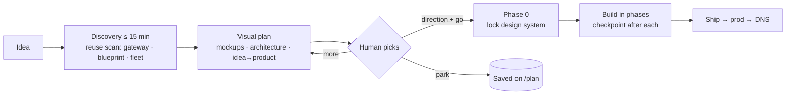

# Planning Workflow — show the outcome before spending the tokens

> Operator direction 2026-09-10. A plan is something a human can judge in **two minutes from pictures**,
> not a document they have to read. Tokens are runway; the plan protects them.

## The rule

**No build over ~100k output tokens starts without an approved visual plan.** The plan itself must cost
under ~150k output tokens and fit on one page.

## What a plan contains (all six, nothing else)

| # | Artefact | Form | Cap |
|---|---|---|---|
| 1 | What it is, for whom, how it makes money | 3 sentences | 60 words |
| 2 | **UI directions to pick from** | Design canvas, 2–3 artboards, motivation + tradeoff per option | 1 canvas |
| 3 | **Architecture** | One mermaid diagram, boxes = deployables | ≤ 12 nodes |
| 4 | **Idea → visual product** | One mermaid flow: what the user gives, what they get | ≤ 8 nodes |
| 5 | Phases | Table: deliverable · build time · output tokens · API-equivalent $ | ≤ 8 rows |
| 6 | Operator actions + honest risks | Checklist + 3 bullets | 10 lines |

Anything longer is the build spec, not the plan. It lives in the repo and nobody is asked to read it.

## How to produce it

1. **Discovery (reuse first).** `grep` the gateway (`runtime/src/`), the blueprint (`AI/templates/blueprint`),
   the fleet (`<dev-root>/*`) and `api_management` for anything already built. List it in the plan as
   "do not rebuild". Check agentFlow / connect before inventing a workflow.
2. **Mockups.** Run the `design` skill: 2–3 genuinely different directions as artboards (`Main` = leading),
   real listing copy, `[YOUR BRAND]` placeholders, sample prices marked as sample. Run the canvas helper
   **in Docker** (`docker run --rm -v … node:24-alpine node /skill/seed-canvas.mjs …`), never `node` on host.
3. **Diagrams.** Mermaid in the plan page (artifacts render it natively). Architecture + idea→product only.
4. **Page + source.** Publish one Artifact page (`AI/plan/<slug>-plan.md` is the committed source). Link the canvas
   from the page. Register with `plan_set` so it shows on the dashboard `/plan`.
5. **Ask for the pick, then stop.** Reply: canvas link · page link · one table · one question
   ("A, B or C — and go?"). No prose recap.
6. **On go.** Record the chosen direction in the md + brain atom, lock the design system in Phase 0, build.

## Reply style (applies everywhere, not just plans)

- Lead with a link, an image, a diagram or a table. Prose only for what those cannot carry.
- One screen. If it needs a header, it is too long for a reply — put it in the page.
- Never restate the plan in chat after publishing it.

## Where this sits next to agentFlow and connect

- **agentFlow** (Idea › Plan › Gap › BRD › TRD › Design › Build › Ship, approve/reject gate per stage, live on
  Vercel) is the long-form host for multi-week projects. Its Design stage emits *files*, not pictures — the gap
  this workflow fills. When agentFlow's Design stage can attach a canvas + mermaid, plans can live there.
- **connect** is post-launch feedback (bugs, features, voting). Not a planning tool.
- This workflow is the **default** for any new build; agentFlow when the operator asks for the full pipeline.

## Keyword

`plan <idea>` runs steps 1–5 and stops at the pick. `go` (with a direction) starts Phase 0.

## Managing a plan (lifecycle)

| Status | Meaning | Recorded where |
|---|---|---|
| `draft` | discovery done, page not yet published | `AI/plan/<slug>-plan.md` header |
| `awaiting pick` | page + canvas live, human has not chosen | same + handoff ACTION |
| `rejected` | directions refused — keep the files, mark the round, ask for references | `AI/plan/design/<slug>/README.md` round table + project memory |
| `approved` | direction chosen (record which, and any mix) | plan md `Decision:` line + brain atom + `plan_set` |
| `building` / `shipped` | phases in flight / v1 live | phase table checkboxes + handoff |

Rules: one page URL and one canvas URL per plan for its whole life (republish, never re-create). Design working
files live in `AI/plan/design/<slug>/` (artboards + `canvas.json` + README with the revise command); scratchpad
copies are disposable. A rejected round stays in the repo so the next round does not repeat it. A new round starts
from what the human supplied (reference sites, screenshots, one word per reference on what works), never from
invented directions. Creating a plan = `plan <idea>` (steps above); revising = edit files → re-seed in Docker →
republish to the same URLs → update the status row.
